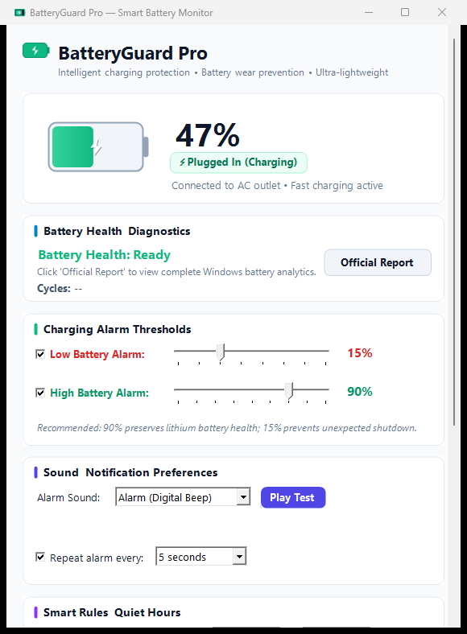
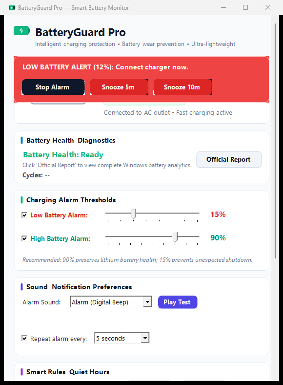
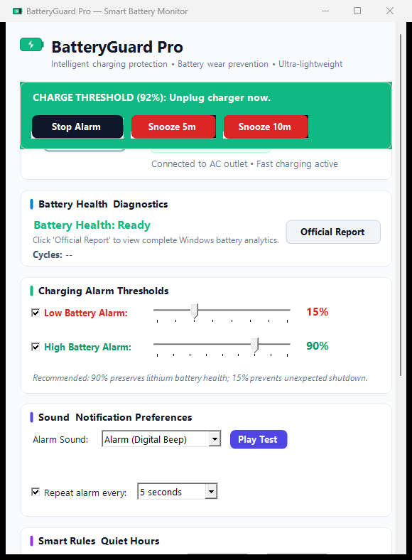

# 🔋 BatteryGuard Pro

[](https://github.com/ajink/battery_charging_status)
[](https://github.com/ajink/battery_charging_status/releases)
[](https://github.com/ajink/battery_charging_status)
[](https://github.com/ajink/battery_charging_status)
[](LICENSE)

An **ultra-lightweight (~69 KB)**, portable, native Windows 11 & 10 utility that tracks your laptop charging state in real-time, displays health analytics, and sounds customizable alarms when your battery crosses safe thresholds.

Designed with a **premium, white Fluent UI**, responsive card layout, smart quiet hours, and virtually **zero CPU/RAM/Battery footprint**.

---

## 📥 Download (Easy 1-Click Setup)

Choose either option below to get started immediately:

| Format | Download Link | Description |
| :--- | :--- | :--- |
| **Direct Executable** | [⬇️ **Download BatteryGuard.exe**](release/BatteryGuard.exe?raw=true) *(~72 KB)* | Ready-to-run single file. No install, no setup required. |
| **ZIP Package** | [📦 **Download BatteryGuard-v1.0.0-Portable.zip**](release/BatteryGuard-v1.0.0-Portable.zip?raw=true) *(~35 KB)* | Includes `BatteryGuard.exe` + Quick Start Guide. |

> [!TIP]
> **No installation needed**: Simply download `BatteryGuard.exe`, place it anywhere on your laptop (e.g. `Desktop`, `Documents`, or `C:\Tools\`), and double-click to launch. You can also copy it to a USB flash drive and run it on any Windows laptop!

---

## 📸 Screenshots & Visual Interface

<div align="center">

### Modern White Windows 11 Fluent Interface

| 🖥️ Live Dashboard & Health Diagnostics | ⚠️ Low Battery Warning Banner | ⚡ Charge Protection Alert |
| :---: | :---: | :---: |
|  |  |  |

</div>

---

## 🚀 3-Step Quick Start Guide

1. **Launch the App**: Double-click `BatteryGuard.exe`.
2. **Set Your Preferred Limits**:
   - **Low Alert** (default **15%**): Warns you to plug in before the laptop shuts down.
   - **High Alert** (default **90%**): Warns you to unplug to extend lithium battery lifespan.
   - Select your alert sound (Digital Alarm, Melodic Chime, Urgent Siren, or custom `.wav`).
3. **Save & Minimize**: Click **"💾 Save Settings"**, then click **"📥 Hide to Tray"** (or click `[X]`). The app will run silently in your Windows system tray.

---

## ⚡ Real-World Resource Footprint (Virtually Zero)

Most modern background tools are built with Electron or Chromium and waste hundreds of megabytes of RAM and keep your CPU waking up. **BatteryGuard Pro is built with pure, native C# (.NET 4.8)** using Windows ACPI hardware events:

| Metric | BatteryGuard Pro | Typical Electron / Web App | Real-World Impact |
| :--- | :--- | :--- | :--- |
| **💾 Disk Space** | **~69 KB** (ZIP is 35 KB) | 150 MB – 300 MB | Takes up virtually nothing. |
| **🧠 RAM Usage (Tray)** | **~8 MB – 18 MB** | 180 MB – 450 MB | Negligible impact on multitasking. |
| **⏱️ Idle CPU Usage** | **0.0%** (Event-driven sleep) | 0.5% – 3.0% background poll | CPU sleeps between updates. |
| **🔋 Battery Consumption** | **< 0.001% per day** | Noticeable passive battery drain | **Zero extra battery drain**. |

> [!NOTE]
> When minimized to the system tray, Windows automatically trims the application working set down to **~8–12 MB of RAM**. It uses less power than rendering a single frame on your screen!

---

## ✨ Full Feature Overview

### 1. 🛡️ Intelligent Charge Protection
- **High Threshold Alarm (Default 90%)**:
  Alerts you when charging reaches 90% (or your chosen level) so you can unplug and avoid keeping the cells at high saturation voltage.
  - **Auto-Stop**: Unplugging the charger silences the alarm immediately!
- **Low Threshold Alarm (Default 15%)**:
  Alerts you when on battery and charge drops to 15% (or your chosen level).
  - **Auto-Stop**: Plugging in the charger silences the alarm immediately!
- **100% Full Charge Reminder**:
  Optional gentle reminder when battery hits 100% to protect long-term battery cell health.

### 2. 📊 Built-In Battery Health Diagnostics
- Instant calculation of **Battery Health %** based on Factory Design Capacity vs. Current Full Charge Capacity.
- Displays **Battery Cycle Count**, Chemistry (Li-Ion), and Manufacturer.
- **📄 1-Click Official Windows Battery Report**: Click one button to generate and open Windows' complete interactive HTML battery life & degradation report.

### 3. 🌙 Smart Quiet Hours (Do Not Disturb)
- Schedule sleep/work hours (e.g. 10:00 PM to 07:00 AM).
- During quiet hours, audible alarms are automatically muted while silent visual balloon notifications remain active so your sleep or meetings are never disrupted.

### 4. 🔊 Built-In Sound Synthesizer
- Includes 4 built-in synthesized alerts that require **zero external sound files**:
  1. **Digital Alarm (Beep-Beep)**: Classic urgent electronic buzzer.
  2. **Melodic Chime**: Pleasant 4-note bell chime.
  3. **Urgent Siren**: Alternating two-tone emergency alert.
  4. **Windows System Alert**: Uses standard Windows exclamation chime.
  5. **Custom WAV**: Choose any `.wav` audio file from your PC with the file picker!
- Includes interactive **"▶ Test"** button to preview sounds.
- Configurable repeat loop (every 3s, 5s, 10s, 15s, or play once).

### 5. ⏰ Smart Snooze & Dismiss Controls
- Quick actions right on the active alarm banner:
  - `[⏹ Stop Alarm]` — dismisses alarm for the current charging cycle.
  - `[⏰ Snooze 5m]` — silences alarm for 5 minutes.
  - `[⏰ Snooze 10m]` — silences alarm for 10 minutes.
- Also available via the right-click System Tray menu.

### 6. 🎨 Premium White Windows 11 UI
- Clean, modern light aesthetic with high contrast text and generous padding.
- Visual custom battery gauge with dynamic color gradients (Emerald Green, Amber, Crimson Red).
- Pill status badges (`⚡ Plugged In (Charging)`, `🔋 On Battery`, `⚠️ Low Level`).
- Fully **responsive across all screen resolutions and high-DPI scaling** (100%, 125%, 150%, 200%).

### 7. ⚙️ Startup & Behavior Controls
- **Start with Windows**: Automatically launches on boot (registers cleanly in `HKCU\Software\Microsoft\Windows\CurrentVersion\Run`).
- **Start minimized**: Starts silently in the tray without popping up.
- **Minimize to tray on close [X]**: Prevents accidental closures.
- Settings are saved automatically in portable `battery_settings.json` (or `%AppData%`).

---

## 🛡️ Edge Cases & System Scenarios Handled

| Scenario | Handled Behavior |
| :--- | :--- |
| **Charger plugged in during low alarm** | Alarm ceases immediately without requiring any clicks. |
| **Charger unplugged during high alarm** | Alarm ceases immediately to confirm charging has stopped. |
| **User clicks Snooze** | Silences audio instantly; re-checks only after snooze timer expires. |
| **Quiet hours active at night** | Alarms are muted; visual notification is shown with a quiet tag. |
| **Desktop PC / AC-only (No battery)** | Gracefully detects missing battery, shows desktop mode message, and idles safely. |
| **Laptop sleep / hibernation / wake** | Listens to Windows `PowerModeChanged` events to update readings the moment the laptop wakes up. |
| **High-DPI laptop screens (125%–200%)** | Fully DPI-aware with crisp vector text and no blurry scaling. |
| **Multiple instances prevented** | Single-instance system mutex ensures only one process runs; re-opening brings the existing window to front. |
| **Custom audio file moved or deleted** | Automatically falls back to built-in synthesized alarm tone so alerts are never missed. |

---

## 🛠️ Building from Source (No Extra Tools Needed)

You don't need Visual Studio, .NET SDK, Python, or node.js to compile this project. It compiles directly using the built-in Microsoft C# compiler present on every Windows installation:

```cmd
# Using Command Prompt:
.\build.bat

# Or using PowerShell:
.\build.ps1
```

To run the automated verification test suite:
```powershell
& "C:\Windows\Microsoft.NET\Framework64\v4.0.30319\csc.exe" /target:exe /out:run_tests.exe /r:System.dll /r:System.Drawing.dll /r:System.Windows.Forms.dll /r:System.Data.dll /r:System.Xml.dll src\AppSettings.cs src\AudioAlert.cs src\BatteryHealthService.cs src\BatteryMonitor.cs tests\ScenarioTests.cs
.\run_tests.exe
Remove-Item run_tests.exe
```

---

## 📜 License

Distributed under the MIT License. Completely free for personal and commercial use on all your Windows laptops.
